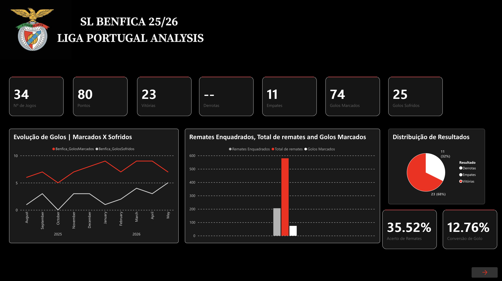
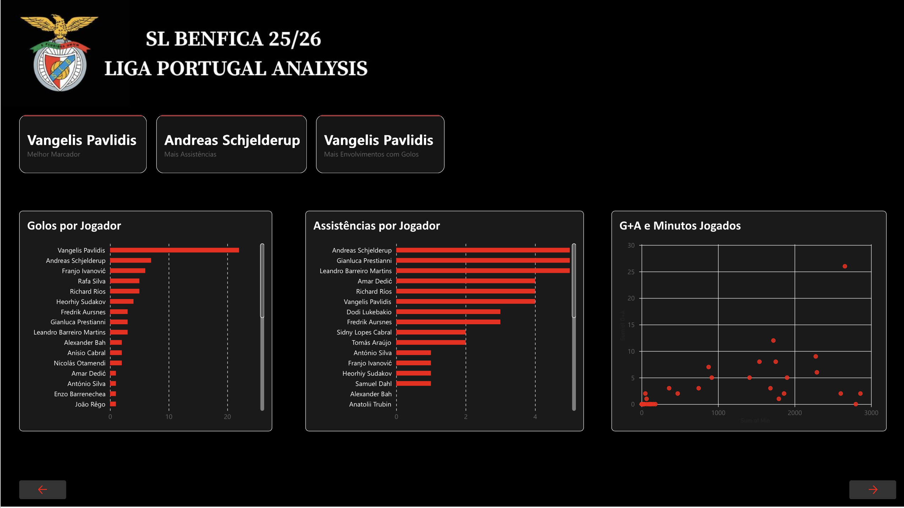
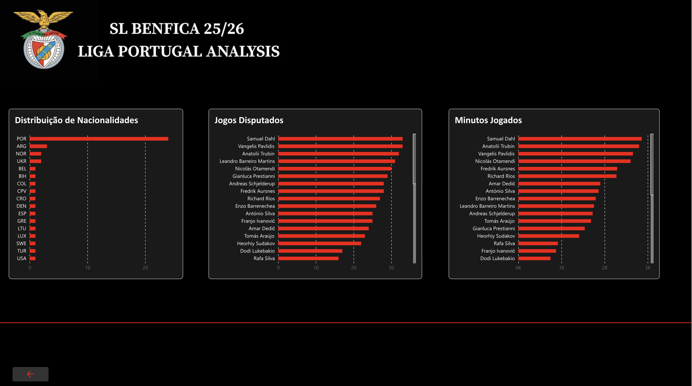

# 🦅 SL Benfica - Liga Portugal Analysis (2025/2026)

<p align="center">
  
  
  
  
</p>

---

## 📌 Project Overview

This repository contains an end-to-end Business Intelligence project analyzing **SL Benfica's performance in the 2025/2026 Liga Portugal season**. The dashboard delivers data-driven insights into team dynamics, match outcomes, individual player contributions, and squad workload management across the entire campaign.

Built entirely using **Power BI**, **DAX**, and **Power Query**, this project showcases the full BI lifecycle from raw Excel data extraction to an interactive three-page executive report styled with Benfica’s iconic visual identity.

---


## 📊 Season Summary KPIs

> [!NOTE]
> **2025/2026 League Performance Snapshot**

| 🏟️ Games | 🏆 Points | 🥇 Wins | 🤝 Draws | ❌ Losses | ⚽ Goals For | 🛡️ Goals Against |
| :---: | :---: | :---: | :---: | :---: | :---: | :---: |
| **34** | **80** | **23** | **11** | **0** | **74** | **25** |

* **Shot Accuracy (Acerto de Remates):** `35.52%`
* **Goal Conversion (Conversão de Golo):** `12.76%`
* **Win Rate:** `68%`

---

## 🖥️ Dashboard Views & Features

<p align="center">
  
   
   
</p>

### 📍 Page 1: Season Overview & Team Metrics
Tracks high-level campaign statistics and macro performance trends:
* **Monthly Goal Evolution:** Comparative line graph tracking goals scored vs. goals conceded from August 2025 to May 2026.
* **Shooting Efficiency:** Bar chart detailing target shots vs. total attempts vs. actual goals scored.
* **Results Breakdown:** Pie chart highlighting the win/draw distribution across 34 matchdays.

### 🎯 Page 2: Player Performance & Attack Analytics
Evaluates individual offensive contributions and player efficiency:
* **Key Leaderboard Callouts:**
  * ⚽ **Top Goalscorer:** Vangelis Pavlidis
  * 🅰️ **Top Assist Leader:** Andreas Schjelderup
  * 🔥 **Most Goal Involvements:** Vangelis Pavlidis
* **Individual Rankings:** Detailed breakdown of goals and assists per player.
* **Efficiency Scatter Plot:** Matrix mapping total Goal Involvements ($G + A$) against Minutes Played ($Min$).

### 👥 Page 3: Squad Demographics & Workload
Focuses on squad roster depth, player origin, and physical load:
* **Nationality Distribution:** Demographics breakdown led by Portuguese players alongside international talent from Argentina, Norway, Ukraine, and Belgium.
* **Matches & Minutes:** Leaderboard ranking the most utilized players (Samuel Dahl, Anatolii Trubin, Vangelis Pavlidis, and Nicolás Otamendi).

---

## 🛠️ Tech Stack & Skills Demonstrated

* **Microsoft Excel:** Source data formatting and initial tabular structuring.
* **Power Query:** ETL pipeline creation, data cleaning, type conversion, and table normalization.
* **Data Modeling:** Designed a Star Schema relational model separating facts (match statistics, player stats) from dimension tables.
* **DAX Engine:** Formulated advanced measures for shooting accuracy (`35.52%`), conversion rates (`12.76%`), and dynamic KPI metrics.
* **Data Visualization & UX:** Built a high-contrast dark theme UI with Benfica red accents (`#E30613`), custom card containers, scatter matrix charts, and page navigation actions.

---

## 📂 Repository Structure

```
├── data/                               # Raw Excel source data files
├── docs/                               # Dashboard screenshots and visual media
│   ├── dashboardPage1.png              # Overview Page
│   ├── dashboardPage2.png              # Offensive Performance Page
│   └── dashboardpage3.png              # Demographics & Minutes Page
├── Benfica_LigaPortugal_2526.pbix      # Main Power BI Desktop file
└── README.md                           # Documentation
```

---

## 💡 How to Run the Project

1. Clone or download this repository to your local machine.
2. Open `Benfica_LigaPortugal_2526.pbix` using **Power BI Desktop**.


---

## 📜 License & Intellectual Property

This project is open-source and available under the [MIT License](LICENSE). 

* **Data Rights:** The SL Benfica name, logo, and original match statistics belong to their respective copyright holders (SL Benfica / Liga Portugal). This project was developed strictly for educational and portfolio demonstration purposes.
* **Dashboard Design & DAX Code:** © 2026 Diogo Sakellarides Salgado. Free to use for reference with proper attribution.


